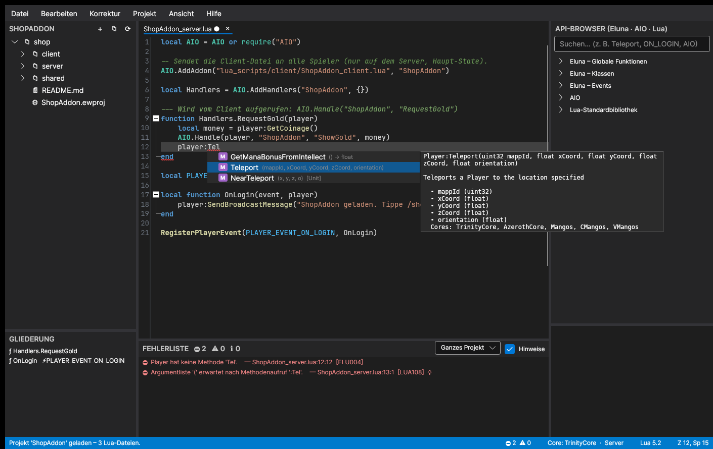
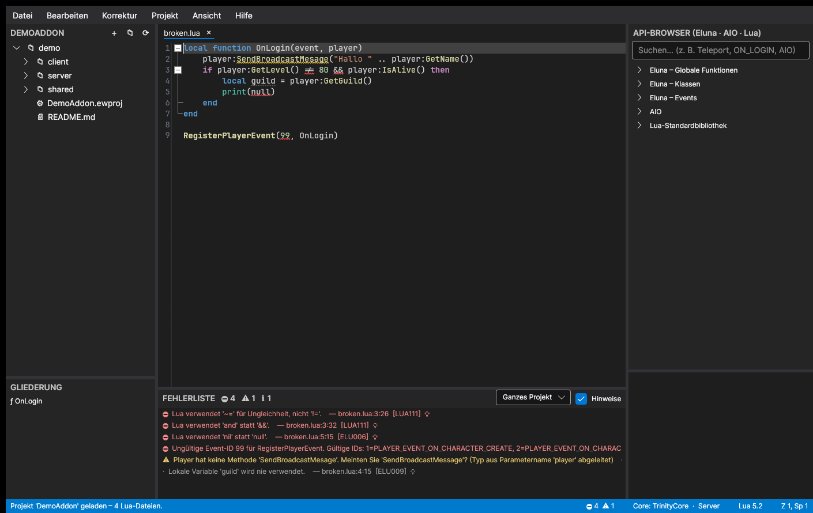

# Eluna Workbench

Ein Editor für Skripte der [Eluna Lua Engine](https://github.com/ElunaLuaEngine/Eluna) und für
[AIO](https://github.com/Rochet2/AIO)-Addons. Geschrieben in C# (.NET 8) mit [Avalonia](https://avaloniaui.net/)
und AvaloniaEdit. Er läuft unter Windows, Linux und macOS.



## Funktionen

### Projektstruktur
- Projekte (`*.ewproj`) mit Projekt-Explorer: Dateien und Ordner anlegen, umbenennen und löschen.
  Änderungen auf der Festplatte werden automatisch übernommen.
- Projektvorlagen:
  - **Leeres Projekt**
  - **Eluna-Serverskripte** (`server/`, `lib/` mit Beispielen)
  - **AIO-Addon** (`server/`, `client/`, `shared/` mit lauffähigem Server- und Client-Beispiel)
- Dateivorlagen: Player-Events, Creature-AI mit Timer, Gossip-NPC, Server-Events, Datenbankabfrage,
  AIO-Server und AIO-Client.
- Ein beliebiger vorhandener `lua_scripts`-Ordner lässt sich als Projekt öffnen.
- Projekteinstellungen: Emulator-Core (TrinityCore, AzerothCore, Mangos, CMangos, VMangos), Lua-Version
  (5.1, 5.2, 5.3, 5.4, LuaJIT), Client-Ordner für AIO und welche Diagnosen aktiv sind.
- **Deploy** (F6): kopiert alle Skripte in den `lua_scripts`-Ordner des Servers.
- Dateiübergreifende Analyse: Globale Variablen und Funktionen aus anderen Projektdateien sind bekannt.
  Das gilt für Diagnosen, Vervollständigung und „Gehe zu Definition“.
- Gliederung der Funktionen der aktuellen Datei. Event-Handler sind darin markiert.

### Autovervollständigung
- Die Grundlage ist die **vollständige Eluna-API**: 21 Klassen, über 1100 Methoden, 109 globale Funktionen
  und 230 Events. Sie wird mit `tools/generate_eluna_api.py` direkt aus den Eluna-Quellen erzeugt und enthält
  Dokumentation, Parameter, Rückgabetypen und unterstützte Cores.
- **Typinferenz**:
  - `player:` zeigt nur `Player`-Methoden, einschließlich der geerbten von `Unit`, `WorldObject` und `Object`.
  - Rückgabetypen werden weitergereicht: `player:GetMap():` zeigt `Map`-Methoden.
  - Parameter von Event-Handlern erhalten ihre Typen aus dem registrierten Event.
    Beispiel: `RegisterPlayerEvent(7, function(event, killer, killed) …)` ergibt `killer: Player` und
    `killed: Creature`. Das funktioniert auch für vorher deklarierte `local function`s und Event-Konstanten
    (`local PLAYER_EVENT_ON_LOGIN = 3`).
  - Handler von AIO (`AIO.AddHandlers`) erhalten `player: Player`. `AIO.Msg():Add(...):Send(...)` ist ebenfalls typisiert.
- **Event-IDs**: Innerhalb von `Register*Event(` werden alle IDs mit Namen und Handler-Parametern angeboten.
  Danach folgt ein passender `function(event, player)`-Handler.
- **Event-Snippets**: Tippen Sie z. B. `PLAYER_EVENT_ON_LOGIN` oder `CREATURE_EVENT_ON_DIED`. Eingefügt werden
  der Handler mit den richtigen Parametern und die Registrierung.
- Weitere Snippets: `gossip`, `dbquery`, `timer`, `forplayers`, `aioserver`, `aioclient` und andere.
- Lua-Standardbibliothek (`string`, `table`, `math`, `os`, `io`, `coroutine`, `debug`, `bit32`, `bit`, `utf8`),
  AIO-API sowie eine Teilmenge der WoW-Client-API in AIO-Client-Dateien.
- **Parameter-Info** (Signaturhilfe) beim Tippen von `(` und `,`.
- **Hover-Dokumentation** für Methoden, Funktionen, Variablen (mit erkanntem Typ) und Event-IDs.

### Syntax-Highlighting
- Lua-Syntax einschließlich langer Strings und Kommentare (`[[ ]]`, `[==[ ]==]`), Escapes und Labels.
- Eigene Farben für Eluna-Funktionen, die Lua-Bibliothek, AIO, WoW-Client-Funktionen, Methodenaufrufe und Konstanten.
- Code-Folding für Blöcke, Tabellen und Kommentarblöcke.
- Wird der Cursor auf eine lokale Variable gesetzt, werden alle Vorkommen hervorgehoben.

### Fehlererkennung und Korrekturfunktionen
Fehler werden live mit Wellenlinien markiert und zusätzlich in der Fehlerliste aufgeführt (aktuelle Datei oder ganzes
Projekt). Mit **Strg+.** oder per Rechtsklick lässt sich eine angebotene Korrektur direkt anwenden.

| Prüfung | Beispiel | Korrektur |
|---|---|---|
| Syntaxfehler mit Fehlererholung | fehlendes `end`, `then`, `)` … | fehlendes `end` an der richtigen Stelle einfügen (anhand der Einrückung) |
| Operatoren aus anderen Sprachen | `!=`, `&&`, `\|\|`, `!`, `+=`, `++` | `~=`, `and`, `or`, `not`, `x = x + …` |
| Fremde Bezeichner | `null`, `this`, `True` | `nil`, `self`, `true` |
| Unbekannte Eluna-Methode | `player:GetNmae()` | „Meinten Sie `GetName`?“ |
| Methode mit `.` statt `:` aufgerufen | `player.GetName()` | `player:GetName()` |
| Ungültige Event-ID | `RegisterPlayerEvent(99, …)` | nächstgültige ID |
| Handler ist keine Funktion oder wird aufgerufen statt übergeben | `RegisterPlayerEvent(3, OnLogin())` | – |
| Falsche Argumentanzahl | `RegisterPlayerEvent(3)` | – |
| Methode im gewählten Core nicht verfügbar | `creature:AddLootMode()` unter Mangos | – |
| Unbekannte globale Variable (Tippfehler) | `GetPlayerByNam(...)` | „Meinten Sie `GetPlayerByName`?“ |
| Unbekannte Bibliotheksfunktion | `string.lenn`, `AIO.Hanlde` | Vorschlag |
| AIO: Handler nicht registriert, Name falsch geschrieben | `AIO.Handle(player, "Shop", "Buyy")` | „Meinten Sie `Buy`?“ |
| Lua-Version | `//`, Bitoperatoren, `goto`, `<const>`, `unpack` in 5.2+ | `table.unpack`, `load` |
| `else if` statt `elseif` | | `elseif` |
| Unbenutzte lokale Variablen, globale Zuweisung in Funktionen | | `_name` bzw. `local` einfügen |

Weitere Hilfen beim Schreiben:
- **Automatisches `end`** nach Enter hinter `then`, `do` und `function(...)`.
- Automatische Einrückung, auch für `end`, `else` und `until`.
- **Dokument formatieren** (Strg+Umschalt+F).
- „Alle sicheren Korrekturen anwenden“.
- Mit F8 und Umschalt+F8 springen Sie von Problem zu Problem.



### Weiteres
- Ein **API-Browser** mit Suche zeigt alle Klassen, Methoden, Events, die AIO-API und die Lua-Bibliothek.
  Ein Doppelklick fügt den Eintrag ein; bei Events wird ein kompletter Handler eingefügt.
- Suchen und Ersetzen in der Datei (Strg+F/Strg+H), Suche im ganzen Projekt (Strg+Umschalt+F12),
  „Gehe zu Zeile“ (Strg+G), „Gehe zu Definition“ (F12), auch dateiübergreifend.
- Zuletzt geöffnete Projekte. Beim Öffnen eines Projekts werden die zuvor geöffneten Dateien wiederhergestellt.

## Bauen und Starten

Voraussetzung ist das [.NET 8 SDK](https://dotnet.microsoft.com/download).

```bash
dotnet run --project src/ElunaWorkbench
```

So erstellen Sie eine eigenständige Windows-EXE (eine einzelne Datei, die kein installiertes .NET benötigt):

```bash
dotnet publish src/ElunaWorkbench -c Release -r win-x64 --self-contained -p:PublishSingleFile=true -o publish
```

Für Linux verwenden Sie `-r linux-x64`, für macOS `-r osx-arm64`.

Tests ausführen:

```bash
dotnet test
```

Als Argument kann eine `.ewproj`-Datei, ein Ordner oder eine `.lua`-Datei übergeben werden:
`ElunaWorkbench.exe C:\server\lua_scripts`.

## Aufbau

```
src/ElunaWorkbench.Core/        UI-unabhängige Bibliothek
  Api/                          Eluna-API-Datenbank (eluna_api.json), Lua-Stdlib, AIO-API
  Lua/                          Lexer, Parser (Lua 5.1–5.4/LuaJIT, mit Fehlererholung), AST
  Analysis/                     Semantische Analyse: Scopes, Typinferenz, Diagnosen, Korrekturen
  Services/                     Vervollständigung, Signaturhilfe, Hover, Definition, Formatierer, Snippets
  Projects/                     Projektdatei, Vorlagen, Workspace (dateiübergreifender Index)
src/ElunaWorkbench/             Avalonia-Oberfläche (Editor, Explorer, API-Browser, Fehlerliste, Dialoge)
tests/ElunaWorkbench.Core.Tests xUnit-Tests
tools/generate_eluna_api.py     Generator der API-Datenbank aus den Eluna-Quellen
```

### API-Datenbank aktualisieren

Die API wird aus den Doku-Kommentaren der Eluna-Header (`methods/<Core>/*Methods.h`) und aus
`hooks/Hooks.h` erzeugt. Für neue Eluna-Versionen führen Sie aus:

```bash
git clone --depth 1 https://github.com/ElunaLuaEngine/Eluna.git /tmp/Eluna
python3 tools/generate_eluna_api.py /tmp/Eluna src/ElunaWorkbench.Core/Resources/eluna_api.json
```

## Tastenkürzel

| Kürzel | Funktion |
|---|---|
| Strg+Leertaste | Autovervollständigung |
| Strg+Umschalt+Leertaste | Parameter-Info |
| Strg+. | Schnellkorrektur |
| F8 / Umschalt+F8 | nächstes / vorheriges Problem |
| F12 | Gehe zu Definition |
| Strg+K | Kommentar umschalten |
| Strg+Umschalt+F | Dokument formatieren |
| Strg+F / Strg+H | Suchen / Ersetzen |
| Strg+Umschalt+F12 | In Projekt suchen |
| Strg+G | Gehe zu Zeile |
| Strg+S / Strg+Umschalt+S | Speichern / Alle speichern |
| Strg+N / Strg+Umschalt+N | Neue Datei / Neues Projekt |
| F6 | Deploy |

## Hinweis zu den API-Daten

`eluna_api.json` wird aus der Quellcode-Dokumentation der Eluna Lua Engine erzeugt
(© Eluna Lua Engine, GPL-3.0). Die AIO-API-Beschreibungen folgen der README von
[Rochet2/AIO](https://github.com/Rochet2/AIO).
